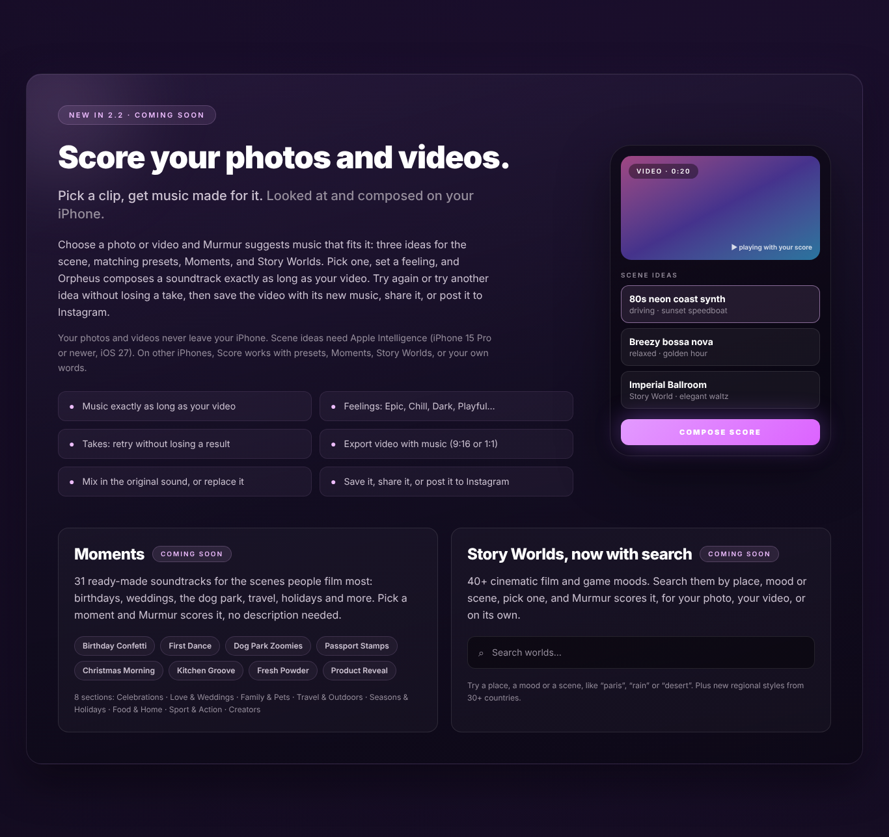
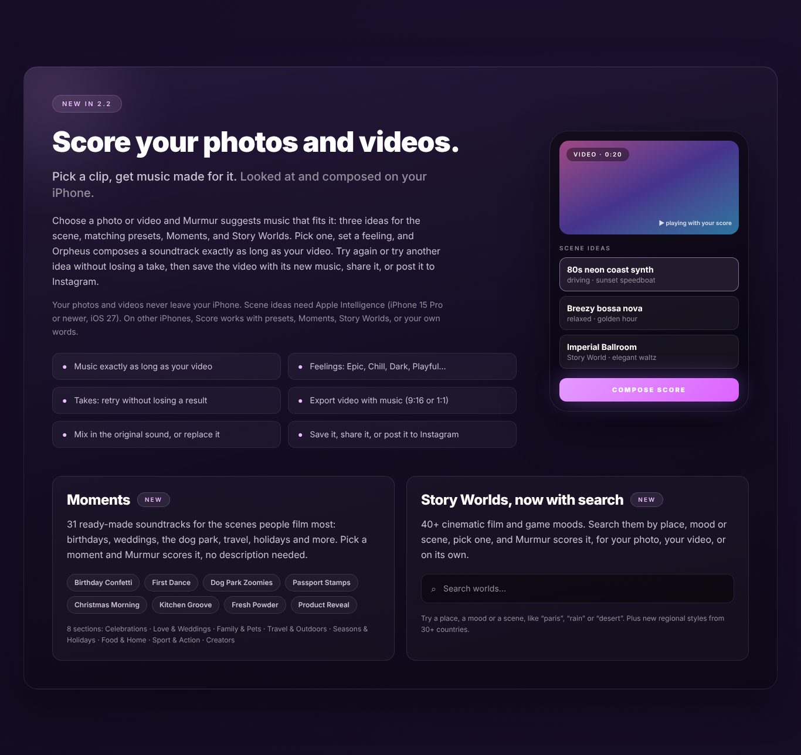
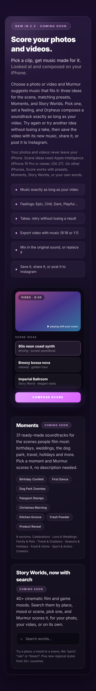
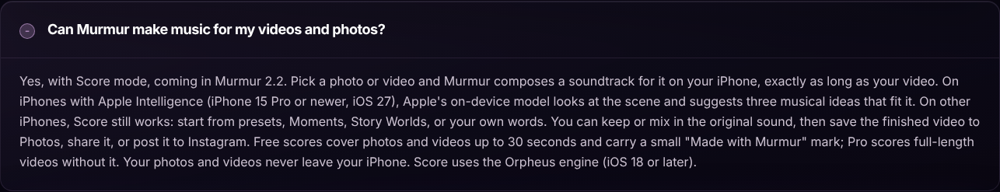
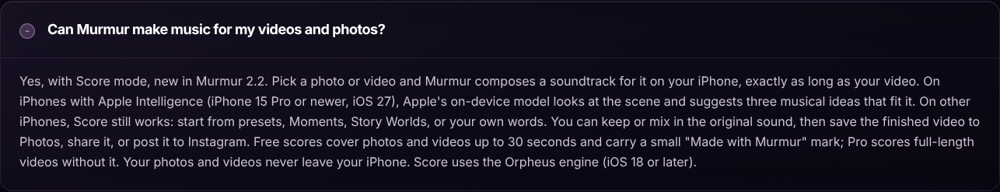
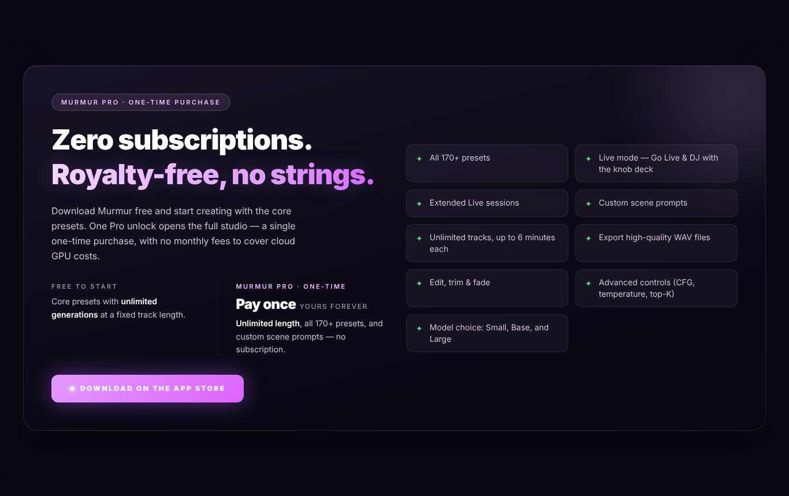
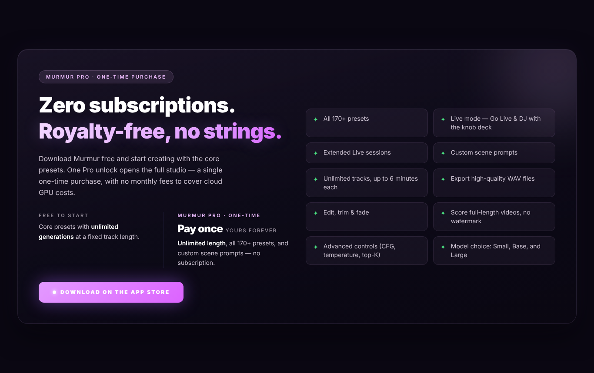

# Report: website update for Murmur 2.2 (branch `score-mode-2.2`)

Cloud session, 2026-10-13. Task 6 of `docs/tasks/CLOUD_QUEUE.md` in the app repo (`Ktabakov/Murmur`, `feature/ios27-intelligence`). Nothing was pushed to `main`, and the live `public/announcements.json` is unchanged.

Sources the copy was checked against:
- `marketing/app-store-localization/en-US.md`;
- `marketing/screenshots/2.2_SCREENSHOT_PLAN.md`;
- `docs/tasks/ios27/05_SCORE_MODE.md`;
- `src/constants/moments.ts`, `src/services/announcements.ts` and `App.tsx` (all from the app repo).

## What changed

### 1. Score section: Moments and Story Worlds search (`src/app/page.tsx`)
- Two new cards inside the Score section, below the existing copy and the mock-up:
  - **Moments**: 31 ready-made soundtracks for everyday scenes. It shows 8 sample chips (one per section, with the app's own names: Birthday Confetti, First Dance, Dog Park Zoomies, …) and the 8 section names. Anchor `#moments`.
  - **Story Worlds, now with search**: 40+ film and game moods, searchable by place, mood or scene. It has a search-field mock-up and the app's own hint examples ("paris", "rain", "desert"), plus one line on the new regional styles from 30+ countries. Anchor `#story-worlds`.
- The Score body copy now names Moments next to presets and Story Worlds.
- The mock-up label "Suggested" became "Scene ideas", the store's term.
- The `{/* LIVE MODE */}` comment had ended up above the Score section. It is back above the Live section.

### 2. "Coming soon" behind ONE constant (`src/lib/release.ts`)
**Release day:** `export const IS_RELEASED_2_2 = false;` → `true`. That one line flips:

| Where | Before release | After release |
|---|---|---|
| Score section badge | New in 2.2 · coming soon | New in 2.2 |
| Moments / Story Worlds card badges | Coming soon | New |
| Score FAQ answer (and its FAQ JSON-LD) | "…Score mode, coming in Murmur 2.2." | "…Score mode, new in Murmur 2.2." |
| JSON-LD `featureList` | (no 2.2 items) | + Score mode, Moments, Story Worlds search |
| Pro perks | (unchanged) | + "Score full-length videos, no watermark" |

To verify this, I built the site with the constant set to `true` and then to `false`, and grepped both `out/index.html` files. The released build has no "coming soon" text left, and the Pro perk and JSON-LD items appear only there.

### 3. Accuracy: Apple Intelligence
- **Score section footnote:** "Scene ideas need Apple Intelligence (iPhone 15 Pro or newer, iOS 27). On other iPhones, Score works with presets, Moments, Story Worlds, or your own words."
  - The old wording was "Automatic ideas need Apple Intelligence on a supported iPhone".
- **FAQ "Can Murmur make music for my videos and photos?"** It was rewritten along the same lines, and also says:
  - free scores are limited to 30 s and carry a "Made with Murmur" mark; Pro scores full length without it (store description, 05 owner decision);
  - Score uses Orpheus (iOS 18 or later).
- **Export wording now matches the store.** "Save it, share it, or post it to Instagram" replaces "Share straight to Instagram or TikTok" and "ready for Instagram, TikTok, or WhatsApp". The app has an Instagram button, but TikTok and WhatsApp are only reachable through the share sheet.

### 4. Stable Audio
The site never uses "Stable Audio" as a selling point; "Powered by Stability AI" stays. The only "Stable Audio" mention is the license attribution in `/terms`, which is required, so I left it alone.

### 5. Draft announcements: `docs/announcements-2.2-draft.json`
The file is in the same format as `public/announcements.json` (`version: 1`), so the entries can be pasted into the live file at release. There are 4 variants, mirroring the 2.1 set. Each one carries every locale the live entries carry: de, fr, es, es-ES, pt-BR, ja.

| id | match | content |
|---|---|---|
| `2026-10-release-notes-2-2-0-ai` | minApp 2.2.0, **minIos 27.0**, Orpheus | Score, the 3 scene ideas "with Apple Intelligence", export, Moments, Story Worlds search |
| `2026-10-release-notes-2-2-0` | minApp 2.2.0, **maxIos 26.99**, Orpheus | Same, but the ideas bullet becomes "start from a preset, a Moment, a Story World or your own words" (no AI promise) |
| `2026-10-release-notes-2-2-0-classic` | minApp 2.2.0, minIos 18.0, Classic | Score + "runs on Orpheus, a one-time 2.1 GB download"; CTA "Try Orpheus" → `murmur://settings/engine` |
| `2026-10-release-notes-2-2-0-ios17` | minApp 2.2.0, maxIos 17.99 | Moments only (Score needs Orpheus, so it isn't available there) |

- The split on minIos/maxIos means every device matches exactly one 2.2 entry, so nobody gets a second 2.2 modal on the next launch.
- `expires` is 2027-03-31.
- **Checked by script:**
  - every title ≤ 80, body ≤ 400 and CTA ≤ 24 characters, which are the app parser's limits in `announcements.ts`; the longest body is fr at 395;
  - ids are unique, and none is already in the live file;
  - no bullet repeats inside an entry;
  - every entry has all 6 locales;
  - the file is valid JSON.
- **Wording follows the app's own strings:**
  - mode names: Vertonen / Illustrer / Musicalizar / Trilha / BGM;
  - Moments: Momente / Moments / Momentos / シーン;
  - the wording follows the 2.2 What's New in each store locale.

### Screenshots (headless Chrome from `out/`, `docs/2.2-website-report/`)
These were rendered from the static export with Playwright's Chromium, with the fixed nav hidden so it doesn't cover the crop.

| | Before release (`false`) | After release (`true`) |
|---|---|---|
| Score section, desktop 1366 px |  |  |
| Score section, mobile 390 px |  |  |
| Score FAQ (open) |  |  |
| Pro card |  |  |

## Verified, and how
- `npm ci && npm run build`: passes. Static export of 7 routes.
- `npm run lint`: **3 problems, all already there before this change**, in files this change doesn't touch. I checked by stashing my changes: the same 3 show up without them.
  - `react-hooks/set-state-in-effect` errors in `mood-prompt-list.tsx:62` and `style-category-grid.tsx:58`;
  - an `` warning in `page.tsx`.

  `page.tsx` and `release.ts` add no new findings. I didn't fix the old ones, so the scope stays the same.
- Release switch: built both ways and diffed (see section 2).
- Announcement draft: checked by script (see section 5).

## On release day
1. In `src/lib/release.ts`, set `IS_RELEASED_2_2 = true`.
2. In `public/announcements.json`, paste the 4 entries from `docs/announcements-2.2-draft.json` at the **top** of `announcements`. File order is the priority.
3. In the same file, **give the three 2.1 entries `"maxApp": "2.1.99"`.** They only have `minApp: 2.1.0` today. Without the cap, a 2.2 user who closes the 2.2 modal gets the 2.1 notes ("37 Story Worlds") on the next launch.
4. Build, then merge `score-mode-2.2` into `main` (that deploys to Pages).

## Open questions / for the owner
1. **Pre-release claims outside the badges.** The hero line ("Score your own photos and videos, …") and the `<meta>` description and keywords in `layout.tsx` already talk about scoring. They came from the earlier commits on this branch, and they aren't behind the constant, since this branch only goes live at release anyway. If the branch will be merged before 2.2 ships, those should go behind `IS_RELEASED_2_2` too.
2. **"170+ presets" vs the store's "200+ styles".** The 2.2 store description says 200+ (about 240 in the code). The site still says 170+ in 6 places. I left it as is because the task didn't cover it, and 170+ is still true. Should it change at release (it could also go behind the constant)?
3. **Japanese name for Moments.** The app's ja UI says 「シーン」, and the announcement draft uses that. The ja store copy says 「Moments」, so one of the two should change.
4. **iOS 17 entry.** This assumes 2.2 still supports iOS 17 and that Moments show in Explore on the Classic engine (`ExploreStylesScreen` doesn't gate the Moments tile, but the Create door tiles are Orpheus-only). Check this on a device, or drop the entry.
5. **No CTA on the Orpheus entries.** `murmur://presets` only switches to the Create tab; there's no route straight into Score. A `presets/score` route in `App.tsx` would allow a "Try Score" button.
6. **Translations** are mine (Claude's); no native speaker has reviewed them, same as the store copy.
